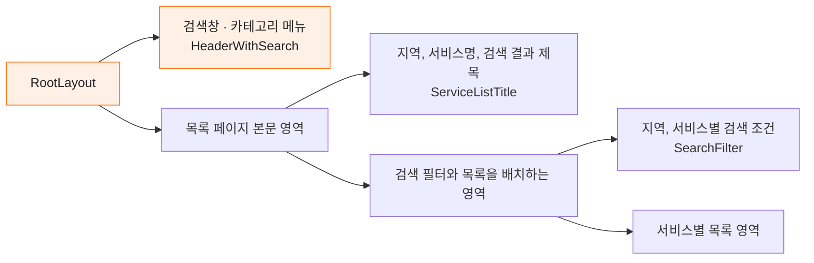
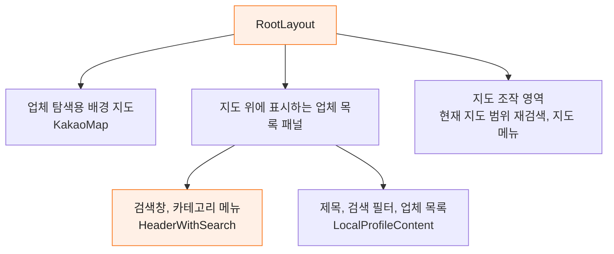
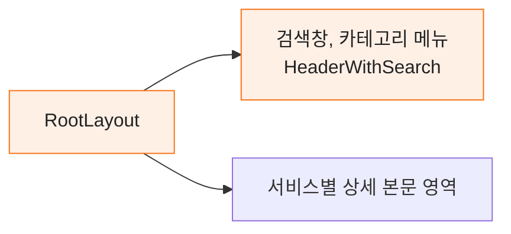

# Carrot Client Clone

당근마켓 웹 사이트를 클론 코딩하는 React 기반 프론트엔드 프로젝트입니다.

현재 프로젝트는 Vite 환경에서 구성되어 있으며, 당근마켓의 주요 화면과 공통 레이아웃을 구현하는 것을 목표로 합니다.

## 기술 스택

### Frontend

- Frontend: React 19, TypeScript
- 상태 관리: TanStack React Query
- 스타일링: Tailwind CSS
- 코드 품질: ESLint, Prettier
- 빌드 및 개발 환경: Vite

## 빠른 시작

### 패키지 설치

```bash
npm install
```

### 개발 서버 실행

```bash
npm start
```

개발 서버가 실행되면 브라우저에서 `http://localhost:5173`으로 접속합니다.

### 개발 서버 실행

```bash
npm run dev
```

### 프로덕션 빌드

```bash
npm run build
```

### 프로덕션 빌드 미리보기

```bash
npm run preview
```

## 레이아웃 구조

각 페이지에서 `RootLayout`과 `HeaderWithSearch`를 직접 조합합니다.
`RootLayout`은 전체 화면의 배경색을 지정하고, 페이지가 화면 높이 이상을 차지하도록 최소 높이를 설정합니다.

주황색은 목록과 상세 페이지가 공유하는 컴포넌트입니다.

### 목록 페이지



| 영역 | 사용하는 컴포넌트 |
| --- | --- |
| 서비스별 목록 | `CardList`, `CarCardList`, `CommunityList`, `GroupList`, `LocalProfileBoardList` |

### 동네업체 목록 레이아웃

동네업체 목록은 배경 지도 위에 목록 패널을 배치합니다.



### 상세 페이지



| 영역 | 사용하는 컴포넌트 |
| --- | --- |
| 서비스별 상세 본문 | `BuySellDetail`, `CarDetail`, `CommunityDetail`, `GroupDetail`, `LocalProfileDetail` |
| 모임 게시판 | `GroupBoardContent`, `GroupBoardDetail` |

## 커밋 메시지 컨벤션

커밋 메시지는 아래 형식을 사용합니다.

```text
type: subject
```

### Type

- `feat`: 새로운 기능 추가
- `fix`: 버그 수정
- `docs`: 문서 수정
- `style`: 코드 포맷팅, 세미콜론 누락 등 동작에 영향이 없는 변경
- `refactor`: 기능 변경 없이 코드 구조 개선
- `test`: 테스트 코드 추가 또는 수정
- `chore`: 빌드 설정, 패키지 관리 등 기타 작업

### 예시

```text
feat: 헤더 메뉴 UI 구현
fix: 로고 이미지 경로 수정
docs: README 빠른 시작 명령어 추가
```
